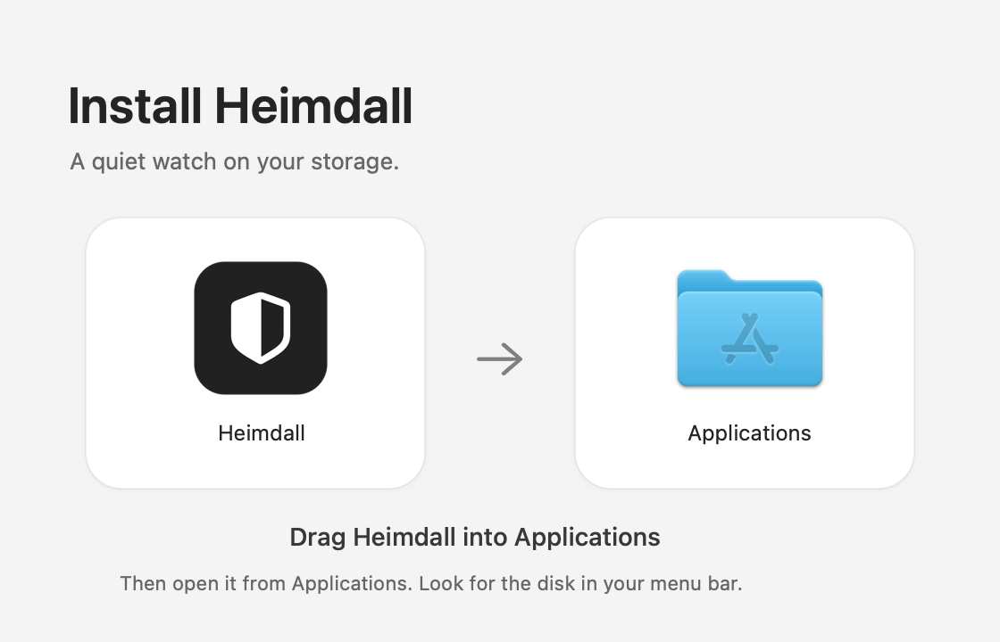
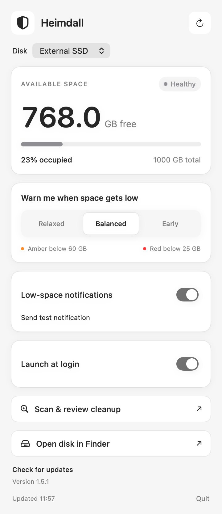
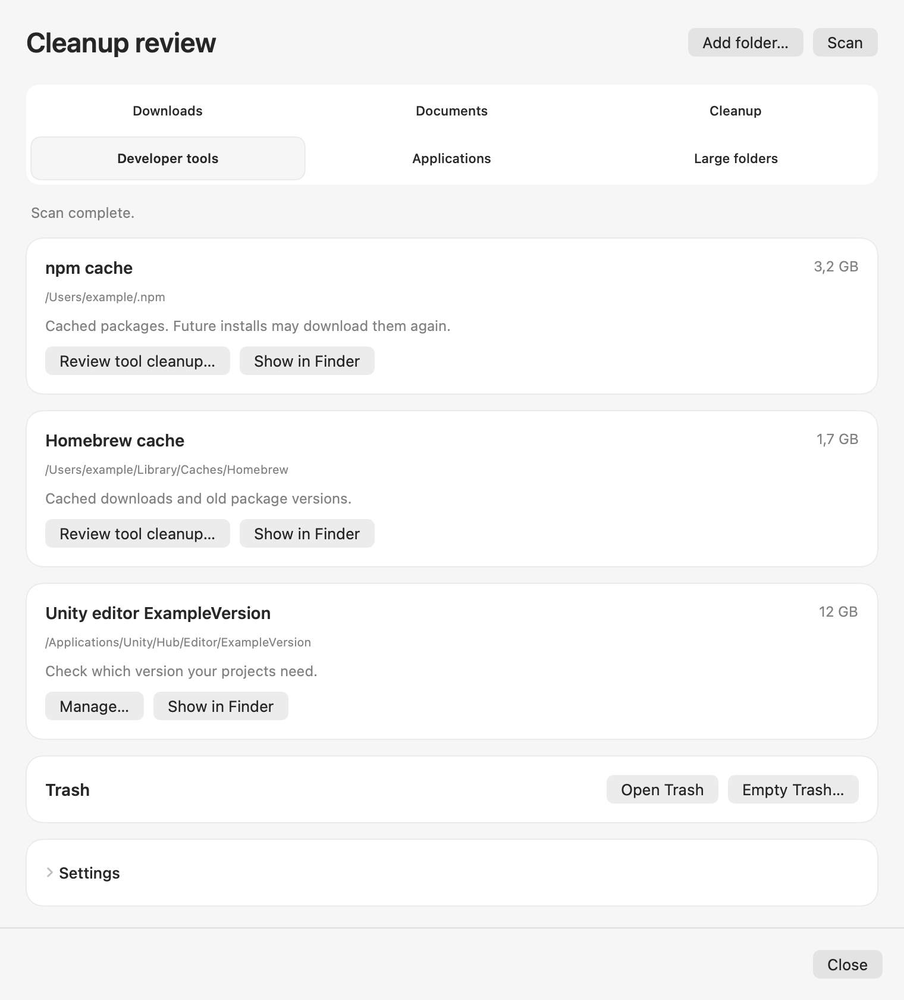
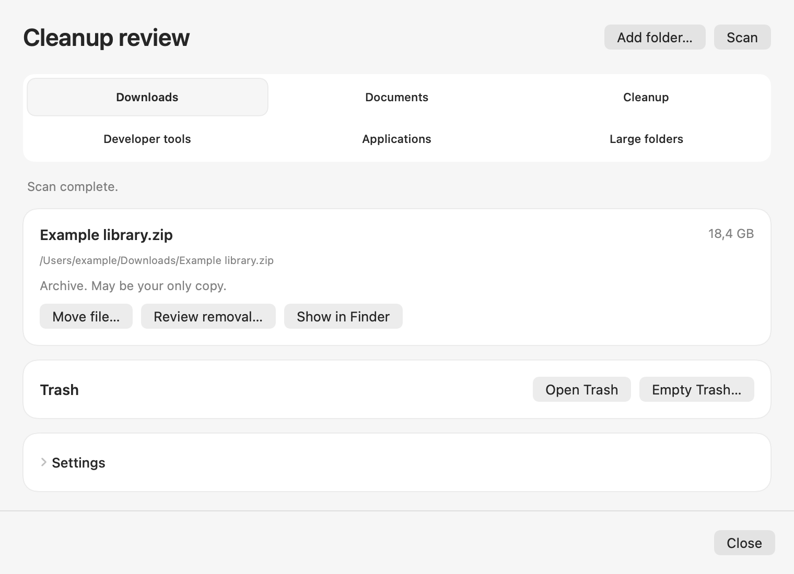
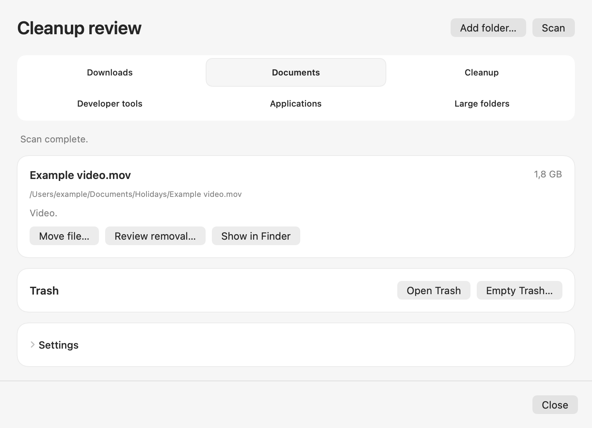
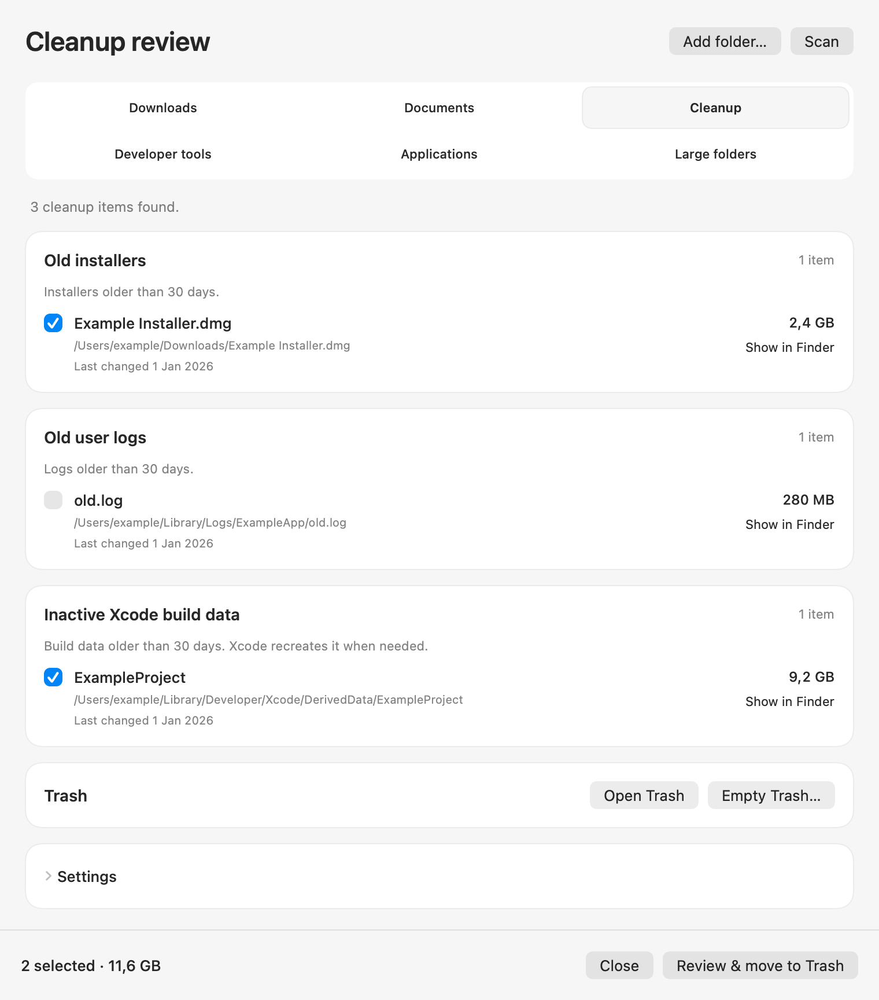

# Heimdall

A tiny native macOS menu bar app that keeps a quiet watch on your disks. See occupancy and available space at a glance: **75% · 128 GB**. Click the menu bar item to open its fluid functionalism panel.

The menu bar uses text only, without a redundant usage icon. Normal readings stay neutral. Amber means space is getting tight; red means it is critical. Text labels make every state clear without relying on color.

## Download and install

Requires **macOS 13 or later**. The universal download supports **Apple Silicon and Intel** Macs.

1. Download **Heimdall-1.5.1-universal.dmg** from the [latest release](https://github.com/theedward/heimdall/releases/latest).
2. Open the disk image and **drag Heimdall into Applications**.
3. Eject the disk image, then open **Heimdall** from Applications.
4. Allow notifications when macOS asks if you want low-space banners. Click the menu bar readout to select a disk, adjust thresholds, or enable **Launch at login**.



*Installer layout preview, using the packaged artwork and icons.*

### First launch

This release is ad-hoc signed, without an Apple Developer ID certificate or notarization. macOS may block the first launch. After attempting to open the app, use **System Settings → Privacy & Security → Open Anyway** if macOS offers it, then confirm opening. Only approve a download you trust. You can also build from the MIT-licensed source below.

For updates, quit Heimdall before replacing the app. If you previously installed it in `~/Applications` using the source installer, replace that copy there rather than keeping two copies in different Applications folders.

## Screenshots

These images are rendered from the same SwiftUI views used by the app. **Every disk reading is made up**, including normal usage. They contain no user's disk figures or file names.




The [design notes](docs/DESIGN.md) describe the fluid functionalism adaptation and preview generation.

## Features

- Select the internal disk or a connected writable external disk. The menu bar remembers your selection, and shows **Disk offline** when it disconnects.
- Refreshes every 30 seconds, on wake, when disks connect/disconnect, and when opening the panel.
- Native macOS low-space banners for all listed disks when a threshold is crossed. A 2 GB recovery margin and 30-minute cooldown reduce repeat warnings; escalation from warning to critical is immediate. First readings, reconnections and preset changes establish a quiet baseline.
- Notification toggle and **Send test notification** button. Clicking a disk warning opens its panel. Delivery follows macOS permissions and Focus settings.
- **Check for updates** contacts GitHub only when clicked. A newer stable version offers **View release**; downloads and installation remain manual.
- Adjustable warning presets: relaxed (30/10 GB), balanced (60/25 GB, default), early warning (100/50 GB).
- **Review & free up space** opens Apple's Storage settings for the internal disk. External disks offer **Open disk in Finder**.
- Launch-at-login toggle, System light/dark appearance, explicit state labels and reduced-motion-aware spring feedback.
- Disk measurements stay local. No analytics or background file scanning. Manual update checks send an app-version User-Agent to the public GitHub API; no disk readings or file names are sent.

## Cleanup review

Click **Scan & review cleanup**, then **Scan**. The window opens on Downloads and also offers Documents, Cleanup, Developer tools, Applications, and Large folders. **Add folder** includes a custom location on any accessible volume; remove it to change the next scan. No external drive or particular folder layout is required. An empty category is a valid result, including on Macs without development tools.

The Cleanup category checks three explicit locations:

- `~/Downloads`: top-level regular `.dmg` and `.pkg` installers.
- `~/Library/Logs`: regular `.log` files and numbered rotations.
- `~/Library/Developer/Xcode/DerivedData`: inactive build folders, only while Xcode is closed.

Candidates must total at least 1 MB and have no creation or modification within the last 30 days. Directories require every descendant to meet the age rule. Linked, protected, unreadable, oversized and source-control-containing build folders are skipped. Scans stop after 60 seconds or their entry limits and report incomplete results. Games, source projects, documents, archives, app data and general caches are outside these Trash rules; the other categories can identify them for manual review. Age alone does not mean you no longer need a file.

Every item starts **unchecked**. Review its reason, size and path; **Show in Finder** opens its location. Select items, click **Review & move to Trash**, and confirm the list. Before each move, Heimdall rechecks location, file identity, metadata, contents of build folders, and whether Xcode is running. Changed items are skipped. Errors are reported per item. These removal actions only move files to Trash; permanent emptying is a separate action.

**Moving to Trash does not free disk space.** Use **Open Trash** to review, then **Empty Trash…** when ready. Heimdall confirms permanent deletion before asking Finder to empty all Trash on connected disks, including items deleted outside Heimdall. Cancel is the default. Finder manages protected/in-use files and may ask for further confirmation. macOS may request Automation permission to control Finder; denial is reported with no fallback deletion. Trash is never emptied automatically, during a scan, or after moving files. Logical sizes are estimates; APFS shared storage and compression can change the actual space reclaimed. Finder can restore trashed items while they remain in Trash.

### General storage opportunities

| Category | Discovery | Reviewed action |
| --- | --- | --- |
| Developer tools | npm, Homebrew, SwiftPM, Gradle and JetBrains caches; Unity editor versions; simulator runtime metadata | Tool-supported purge, manager, or documented controls |
| Downloads | Files of at least 500 MB; also files of at least 5 MB created and modified over 90 days ago, with no recent recorded opening | Move to another folder or individually review removal to Trash |
| Documents | Files of at least 100 MB, including inside visible subfolders; app packages, hidden folders, links and online-only iCloud files are skipped | Move to another folder or individually review removal to Trash |
| Applications | Apps of at least 100 MB in standard or added locations | Review in Finder or use the publisher's uninstaller |
| Large folders | Folders in common personal and app-data locations, plus added locations | Review in Finder; use the owning app's supported relocation method |

The review opens on **Downloads**. Suggestions explain installers, archives, videos and personal files in plain language. Missing last-opened metadata is shown as unknown; age never proves a file is disposable. Documents does not need to be added manually. Folder access may require macOS permission. Each personal-file removal has its own confirmation with **Keep file** as the default, and revalidates the file before moving it to Trash.

Installed and large do **not** mean unused. Runtime last-use metadata is shown when supplied by `simctl`; app/editor usage is explicitly unknown. Folder sizes may be partial because of entry limits or access restrictions. Sizes overlap across categories and must not be added up as guaranteed reclaimable space. Protected and inaccessible locations are reported without requesting full-disk or administrator access.

Cache discovery includes typical locations and custom npm/Homebrew cache locations reported by their installed tools. If a tool is absent, its leftover cache can still be revealed in Finder. Custom installations can be inspected using **Add folder**.

- npm uses its [supported cache purge](https://docs.npmjs.com/cli/v11/commands/npm-cache), with the scanned cache path passed as a separate argument. There is no dry-run; its permanent cache purge requires explicit confirmation.
- SwiftPM uses `swift package --cache-path <path> purge-cache`, from an empty temporary working directory. It purges the global repository cache, not source projects; Xcode must be closed. Reclaimed space can be smaller than the measured folder.
- Homebrew shows its [cleanup dry-run](https://docs.brew.sh/Manpage.html#cleanup-options-formulacask-), then rechecks it before running `cleanup --prune=30`. This can remove old installed formula versions as well as cache downloads. A changed or truncated preview prevents execution.
- [Gradle retention](https://docs.gradle.org/current/userguide/directory_layout.html) and [JetBrains leftover directories](https://www.jetbrains.com/help/idea/directories-used-by-the-ide-to-store-settings-caches-plugins-and-logs.html) use their documented controls; IDE Local History is not swept away by Heimdall.
- Editor/runtime removal is reviewed in [Unity Hub](https://docs.unity.com/en-us/hub/add-editor) or [Xcode settings](https://developer.apple.com/documentation/xcode/downloading-and-installing-additional-xcode-components). Heimdall opens the detected manager, or its guide when unavailable.

Tool cleanup is permanent and may require dependency downloads later. The confirmation shows its exact scope and command; close active builds/installations before approving. The scan never executes cleanup commands. Tool timeouts and failures are reported; a failed cleanup may have made partial changes, so rescan before retrying.

### Relocation without a drive assumption

**Choose destination** opens a native folder picker. The destination can be another folder on the internal disk, a separate internal volume, external storage, or another accessible mounted volume. The destination must have room for the full logical file size plus a 256 MB margin. Existing files are never overwritten.

Heimdall copies the regular file using Foundation, verifies its contents with SHA-256, rechecks source/destination identity and metadata, then moves the original to Trash. File metadata support depends on the destination filesystem. If verification or copying fails, the original stays in place. If moving the original to Trash fails, the verified destination copy and original are both retained and reported. Directories and managed libraries remain manual-review items.

A same-volume relocation does not save space on that volume. Different APFS volumes in one container also share storage. Moving to separate storage can reclaim source space **after its Trash is emptied**. The confirmation explains this before copying.







Under **Settings**, **Review recommended changes** shows proposed Heimdall settings before applying them: Launch at login on, notifications on (subject to macOS permission), and Balanced 60/25 GB thresholds. macOS storage settings are reviewed in their native screens rather than silently changed. Automatic 30-day Trash removal can erase files without another review; keep it off if you want approval before every permanent deletion.

No full-disk access, administrator privilege, scheduled deletion or background file scanning is requested. macOS may ask for Downloads-folder access when you explicitly scan. Declining access leaves that location unavailable and adds a scan note.



*Fictional example after manually selecting two candidates.*

## Build from source

Requires Xcode Command Line Tools with Swift and Python 3. A normal build targets the current Mac's architecture.

```sh
./build.sh
open "build/Heimdall.app"
```

To install in `~/Applications` with launch at login enabled:

```sh
./install.sh
```

Quit an existing instance before installing an update.

### Create the drag-to-Applications installer

```sh
./package-dmg.sh
```

This builds a universal app, creates its icon and installer artwork, installs the pinned `dmgbuild` packaging dependency in a temporary virtual environment, and writes the `.dmg` plus a SHA-256 checksum into `build/`. A custom architecture is optional:

```sh
HEIMDALL_ARCH=arm64 ./package-dmg.sh
```

The packaging tools are build-time dependencies; the downloaded app needs neither Python nor Xcode.

Regenerate the fictional UI pictures:

```sh
"build/Heimdall.app/Contents/MacOS/Heimdall" --render docs/previews
```

## What is measured?

Heimdall reads filesystem statistics for `/System/Volumes/Data`, the standard startup Data volume, and mounted writable local external volumes. Available space is `f_bavail`; occupied space is the volume's reported total minus that available space. APFS volumes share space, so occupied space includes container space unavailable to this volume, rather than just the sum of files in the Data volume. It may differ from `df`'s Capacity column and from Storage Settings' accounting of purgeable space. Potentially purgeable files are not counted as free. Sizes use decimal GB.

Thresholds use absolute free space to preserve room for installs and updates. The percentage describes occupancy. Inspect a real reading without opening the UI:

```sh
"build/Heimdall.app/Contents/MacOS/Heimdall" --check
```

List detected disks with `--list-disks`. Run behavior and release-validation tests with `./test.sh`.

Preferences use `io.github.theedward.heimdall`. Launch at login uses `~/Library/LaunchAgents/io.github.theedward.heimdall.plist`. Turning it off removes that file; enabling it takes effect at the next login. Quit closes the current instance without disabling future login launches.

## Uninstall

Turn off **Launch at login**, quit the app, then move its Applications copy to the Trash. Optionally remove its preferences:

```sh
defaults delete io.github.theedward.heimdall
```

## License

[MIT](LICENSE).
