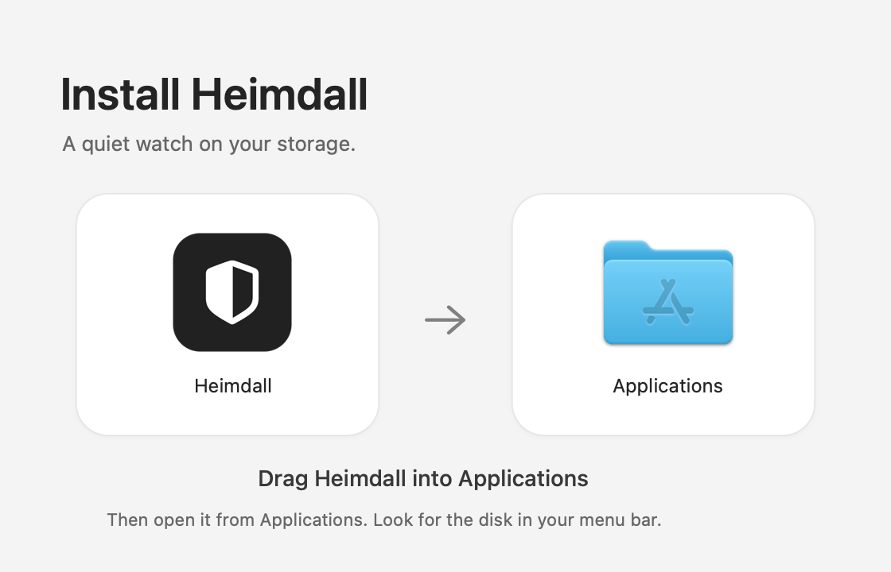
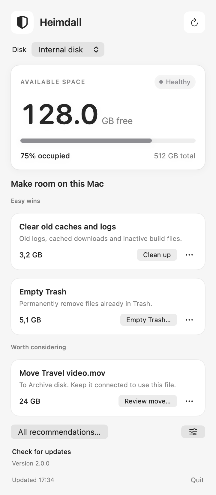
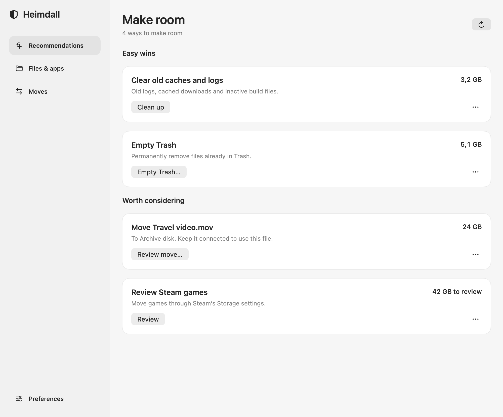
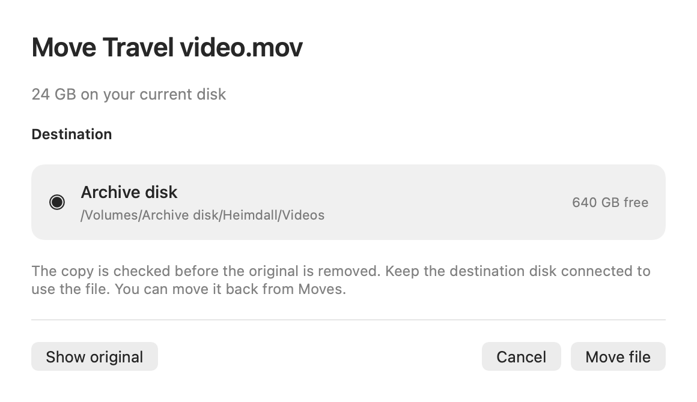
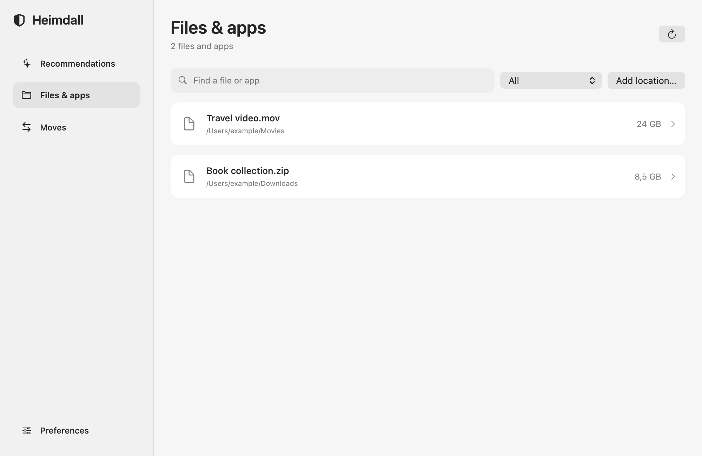

# Heimdall

Heimdall helps you decide where to start making room on your Mac. Open its menu bar panel for concrete recommendations: easy cleanup first, with worthwhile larger moves alongside it.

## Download and install

Requires **macOS 13 or later**. The universal download supports **Apple Silicon and Intel**.

1. Download **Heimdall-2.0.0-universal.dmg** from the [latest release](https://github.com/theedward/heimdall/releases/latest).
2. Open it and **drag Heimdall into Applications**.
3. Eject the installer and open Heimdall.



This release is ad-hoc signed, without Developer ID notarization. If macOS blocks first launch, attempt to open it, then use **System Settings → Privacy & Security → Open Anyway** for a download you trust. Source builds are available below. Quit the previous copy before updating; keep one installation, including if you previously installed under `~/Applications`.

## Start with a recommendation

Discovery starts automatically after launch, refreshes about every 15 minutes, and updates when disks connect or disconnect. No folder setup or manual scan is required. The menu shows up to two **Easy wins** and one **Worth considering**, so a large, useful opportunity remains visible alongside simpler cleanup.

- **Clear old caches and logs** removes eligible old logs, cached package downloads and inactive Xcode build data with one click.
- **Empty Trash** estimates its size and asks for one confirmation before permanent deletion. Finder empties all current-user Trash on connected disks, including files removed outside Heimdall. If access prevents a full estimate, Heimdall shows an incomplete or unavailable size.
- **Review old installers** opens an unchecked list. Choose what you no longer need and send it to Trash.
- **Move a large personal file** proposes a separate connected disk and an organized destination folder.
- **Review a large app, game library or developer component** opens a focused detail view and its appropriate manager or Finder action. Installed size is labeled “to review”; it is not a promise that the entire amount is disposable.

All removal and relocation require a user action. Automatic discovery never deletes, relocates, empties Trash, or changes settings.





Sizes may overlap across suggestions, so Heimdall does not add them into a misleading total. Logical file sizes, APFS snapshots, shared extents and other disk activity can affect actual space recovered.

## Move files without planning a folder layout

Approve a destination in one panel. Heimdall creates `Heimdall/Videos`, `Heimdall/Archives`, `Heimdall/Pictures`, or `Heimdall/Documents` on that disk as appropriate. It never preselects a machine-specific drive name.

Destinations must be writable local volumes backed by real physical storage, with enough free space and a compatible per-file size limit. Volumes sharing the source APFS container are excluded. The destination UUID and backing storage are checked again before execution. Missing mounts, linked destination directories, same-storage moves, collisions, changed files and insufficient space prevent the move.

Heimdall copies the regular file, checks its contents with SHA-256, flushes the copy to storage, and records how to move it back **before permanently removing the original**. The original is not put in Trash, so this can release source space immediately, subject to filesystem snapshots/shared storage. The confirmation explains that the destination must remain connected to use the file. Supported metadata is copied by Foundation; filesystem capabilities vary. Hash verification covers the data fork.

**Moves** keeps a persistent history in `~/Library/Application Support/Heimdall/moves.json`. **Move back** verifies and copies the file to its original folder, then removes the secondary copy. It requires that the file still matches its recorded identity, that the original folder exists and has enough space, and that nothing occupies the old name. Changed or unavailable copies are not removed. If source removal fails, Heimdall retains both files and reports it; history marks an original still present. A journal written before deletion also preserves the destination information if the app is interrupted.

Directories, projects, games and managed libraries are not automatically relocated. Steam libraries are reviewed through Steam Storage; editors and runtimes use their managers. These higher-effort options remain visible when their size makes them worth considering.



## Explore deeper

**All recommendations…** opens a resizable window with a stable sidebar:

- **Recommendations:** ranked, actionable suggestions.
- **Files & apps:** search and filter discoveries; select an item for focused details and actions. **Add location…** is optional and refreshes automatically.
- **Moves:** completed transfers and Move back.
- **Preferences:** login, notifications, warning thresholds and remembered decisions.

Use a suggestion’s **…** control to choose **Keep here** or **Don’t suggest again**. Choices persist across launches and can be restored with **Suggest again** in Preferences. Personal-file choices are remembered by path; a large or old file is never automatically classified as disposable.



## What discovery checks

Downloads, Desktop, Movies, Music and Pictures are checked for large top-level regular files (500 MB or more). Downloads and added locations also include files of at least 5 MB created and modified over 90 days ago, unless recent recorded use says otherwise. Missing last-opened metadata is explicitly unknown. Documents includes visible subfolders and files of at least 100 MB. Links, hidden folders, app packages and online-only iCloud files are skipped for personal-file relocation.

The app also inventories large immediate child folders in common personal and app-data locations, apps in `/Applications` and `~/Applications`, typical developer caches, Steam libraries, Unity editors and simulator metadata. Unreadable locations and entry/time limits are surfaced under scan details. macOS can ask for folder access; denying it leaves that location unavailable. Heimdall does not request administrator or unrestricted full-disk access.

## One-click cleanup boundaries

One-click cleanup permanently removes only eligible items from these explicit locations:

- `~/Library/Logs`: old regular `.log` and numbered log rotations.
- `~/Library/Developer/Xcode/DerivedData`: inactive build folders.
- `~/.npm/_cacache/content-v2`: cached package download contents.
- `~/Library/Caches/Homebrew/downloads`: cached downloads.

Creation and modification must both be over 30 days ago. Build folders require every descendant to qualify. Development data is skipped while detected build/install tools are active or process state cannot be checked. Links, hard-linked regular files, immutable entries, changed items, unreadable folders, cross-device entries and source-control-containing build folders are skipped. Each item is revalidated immediately before removal. Personal Downloads, Documents, games, applications, Local History and Trash are outside this automatic removal path. Later builds or installs may recreate or download removed data.

Other package-cache actions remain separate and reviewed:

- npm uses its [cache purge](https://docs.npmjs.com/cli/v11/commands/npm-cache) with the exact scanned cache path.
- SwiftPM uses `swift package --cache-path <path> purge-cache`, with Xcode closed.
- Homebrew shows [cleanup’s dry-run](https://docs.brew.sh/Manpage.html#cleanup-options-formulacask-), then rechecks it before `cleanup --prune=30`. It can remove old installed formula versions as well as cached downloads; a changed or incomplete preview prevents execution.
- Gradle and JetBrains use their documented controls; Local History is not swept away.

## Disk monitoring and privacy

The menu bar stays text-only: **75% · 128 GB**. Normal readings are neutral; amber and red signal low space. It monitors the startup Data volume and connected writable external volumes every 30 seconds. The selected disk controls the readout; recommendations target the current user’s files, with destination suggestions on separate storage.

Preferences offer relaxed (30/10 GB), balanced (60/25 GB) and early (100/50 GB) warning thresholds. Notifications use a 2 GB recovery margin and a 30-minute warning cooldown; critical escalation is immediate. Initial readings and reconnections establish a quiet baseline. Notification delivery follows macOS permissions and Focus settings.

Scans, file names, remembered choices, disk measurements and move history remain local. No analytics. Manual **Check for updates** contacts GitHub with an app-version User-Agent, without file names or disk readings. Opening a manager’s guide or Storage settings is an explicit user action.

Screenshots are rendered from shared SwiftUI views using entirely fictional files, disks and values. Native light/dark appearances, keyboard focus and Reduce Motion are supported, following [Fluid Functionalism](https://www.fluidfunctionalism.com/docs). See [design notes](docs/DESIGN.md).

## Build from source

Requires Xcode Command Line Tools with Swift and Python 3. A normal build targets the current Mac's architecture.

```sh
./build.sh
open "build/Heimdall.app"
```

To install in `~/Applications` with launch at login enabled:

```sh
./install.sh
```

Quit an existing instance before installing an update.

### Create the drag-to-Applications installer

```sh
./package-dmg.sh
```

This builds a universal app, creates its icon and installer artwork, installs the pinned `dmgbuild` packaging dependency in a temporary virtual environment, and writes the `.dmg` plus a SHA-256 checksum into `build/`. A custom architecture is optional:

```sh
HEIMDALL_ARCH=arm64 ./package-dmg.sh
```

The packaging tools are build-time dependencies; the downloaded app needs neither Python nor Xcode.

Regenerate the fictional UI pictures:

```sh
"build/Heimdall.app/Contents/MacOS/Heimdall" --render docs/previews
```

## What is measured?

Heimdall reads filesystem statistics for `/System/Volumes/Data`, the standard startup Data volume, and mounted writable local external volumes. Available space is `f_bavail`; occupied space is the volume's reported total minus that available space. APFS volumes share space, so occupied space includes container space unavailable to this volume, rather than just the sum of files in the Data volume. It may differ from `df`'s Capacity column and from Storage Settings' accounting of purgeable space. Potentially purgeable files are not counted as free. Sizes use decimal GB.

Thresholds use absolute free space to preserve room for installs and updates. The percentage describes occupancy. Inspect a real reading without opening the UI:

```sh
"build/Heimdall.app/Contents/MacOS/Heimdall" --check
```

List detected disks with `--list-disks`. Run behavior and release-validation tests with `./test.sh`. The `--recommendations-check` diagnostic performs a read-only discovery run and prints only counts, kinds and sizes; it never cleans or relocates anything.

Preferences use `io.github.theedward.heimdall`. Launch at login uses `~/Library/LaunchAgents/io.github.theedward.heimdall.plist`. Turning it off removes that file; enabling it takes effect at the next login. Quit closes the current instance without disabling future login launches.

## Uninstall

Turn off **Launch at login**, quit the app, then move its Applications copy to the Trash. Optionally remove its preferences:

```sh
defaults delete io.github.theedward.heimdall
```

## License

[MIT](LICENSE).
