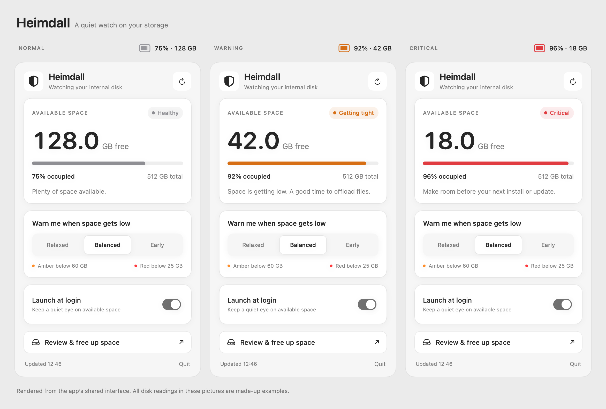
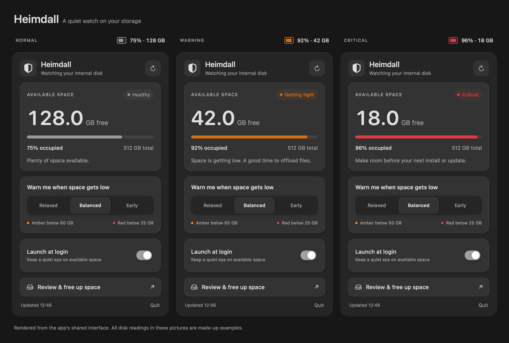

# Heimdall interface

Native adaptation of [Fluid Functionalism](https://www.fluidfunctionalism.com/docs) and its [relative surface hierarchy](https://www.fluidfunctionalism.com/docs/surfaces).

The panel uses neutral nested surfaces, fine borders, quiet shadows, and a free-space-first hierarchy. Normal readings are gray; amber and red signal warning and critical states. State names and explicit thresholds accompany color. Both system light and dark appearances are supported.

The warning preset selector uses a raised selection surface. Press feedback compresses subtly and reverses with spring motion. Reduce Motion removes scaling and spring feedback. Hover/tooltips and keyboard focus use native macOS behavior. The launch-at-login switch is rendered in SwiftUI, using the same implementation in the app and previews.

Pictures are rendered from the actual shared SwiftUI panel and menu bar icon, not drawn mockups. Normal (128 GB free), warning (42 GB free) and critical (18 GB free) all use generated readings to illustrate states without filling the disk. They are visual examples, not evidence that the disk has those free-space values.




Regenerate with:

```sh
./build.sh
"build/Heimdall.app/Contents/MacOS/Heimdall" --render docs/previews
```
